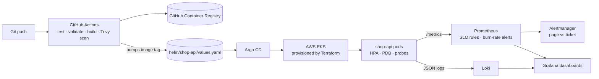

# Cloud-Native Reliability Platform

[](https://github.com/jefflenard007-JJ/reliability-platform/actions/workflows/ci.yml)

A production-style platform for a small orders API (`shop-api`), built to practise platform engineering, observability and SRE: infrastructure as code, GitOps delivery, SLO-based alerting, chaos testing and incident runbooks.



## What's in here

| Area | Path | What it shows |
|---|---|---|
| Service | `app/` | FastAPI service with RED metrics (rate, errors, duration), structured JSON logs, health probes, runtime chaos injection, unit tests |
| Observability | `local/` | Docker Compose stack: Prometheus, Alertmanager, Grafana (dashboards as code), Loki, Promtail |
| SLOs | `local/prometheus/slo-rules.yml`, `alerts.yml` | 99.5% availability and 300 ms latency SLOs, multi-window multi-burn-rate alerts |
| Kubernetes | `helm/shop-api/` | Helm chart: rolling updates, HPA, PodDisruptionBudget, ServiceMonitor, hardened security context |
| GitOps | `argocd/` | Argo CD application with automated sync, self-heal and prune |
| Infrastructure | `terraform/` | AWS VPC and EKS (Sydney region) using the community Terraform modules, spot nodes for cost |
| CI/CD | `.github/workflows/ci.yml` | Lint and test, Helm/Terraform/promtool validation, image build, Trivy vulnerability gate, push to GHCR, GitOps tag bump |
| Reliability | `chaos/`, `runbooks/`, `postmortems/` | Chaos experiments with stated hypotheses, runbooks per alert, blameless postmortem template |

## Run it locally (no cloud cost)

Needs Docker.

```bash
docker compose -f local/docker-compose.yml up -d --build
curl -X POST localhost:8000/orders -H 'content-type: application/json' -d '{"item":"widget","quantity":2}'
```

- Grafana: http://localhost:3000 (admin / admin) → *Reliability Platform* → *shop-api — SLO & RED overview*
- Prometheus: http://localhost:9090/alerts
- Alertmanager: http://localhost:9093

## Run a chaos experiment

```bash
./chaos/run_experiments.sh errors     # 20% error rate → fast-burn alert
./chaos/run_experiments.sh latency    # +400 ms → latency SLO alert
./chaos/run_experiments.sh kill       # container down → ShopApiDown
./chaos/run_experiments.sh reset
```

Watch the dashboard and Prometheus alerts page, then write up what happened in `postmortems/` using the template.

## Deploy to AWS (optional, costs money)

```bash
cd terraform && terraform init && terraform apply
aws eks update-kubeconfig --region ap-southeast-2 --name reliability-platform
# Install Argo CD and kube-prometheus-stack, then:
kubectl apply -n argocd -f argocd/shop-api-application.yaml
# When finished:
terraform destroy
```

## Tests

```bash
cd app && pip install -r requirements-dev.txt && ruff check src tests && pytest -q
promtool test rules local/prometheus/tests/alerts_test.yml   # unit tests for the SLO alerts
```

## Results

<!-- Fill in with your own measurements after running the experiments. Add screenshots to docs/. -->
- Chaos experiment results: _to be recorded_
- Time to detect each injected fault: _to be recorded_
- Dashboard screenshots: _to be added_
